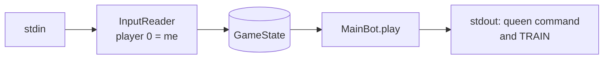
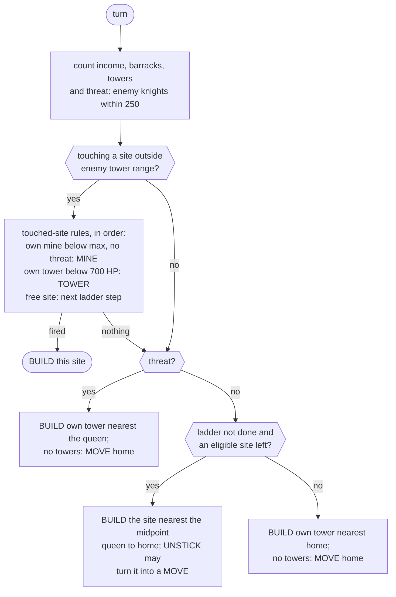

# Bot architecture

Describes `cr.bot.current.MainBot` at commit 18b8311, where `current` with default `Params` plays
as v03. The frozen versions `cr.bot.v01`–`v03.GreedyBot` are copies of this class that differ in
their `Params` snapshot (see [Parameters and versions](#parameters-and-versions)). The same content
in Russian, as a page with diagrams, is `docs/bot-architecture.html` (open it in a browser; its
diagrams load mermaid from the jsDelivr CDN). Update both files when the decision rules in
`MainBot.play` change.

## Summary

A greedy rule bot without search. Each turn it looks only at the current state and walks a fixed
ladder: one knight barracks, then mines up to an income of 3, then up to 8 towers. When enemy
knights come close, the queen flees to her nearest tower. Every barracks trains whenever the gold
allows.

State kept between turns: the starting side (`homeLeft`) and the UNSTICK detour plan. The deadline
is passed to `play` but not read; there is no anytime search. (The only turn-time measurement is for
the artifact of 2026-10-28, later frozen as v01, run as a process: first turn ≤ 165 ms, later turns
≤ 10.5 ms, DEVLOG 2026-10-28. v03 with UNSTICK has not been profiled.)

## One turn: stdin to stdout

On CodinGame everything is merged into one `Player.java` (`FileMerger`), with `CGRunner.main` as the
entry point. The local referee and bench call the same `MainBot.play` in-process, so the decision
code is the same in both.



What the runner does around the bot:

- **Init.** Reads the sites. Until the queen sees a site (vision 300), its gold is assumed to be
  225 and its `maxMineSize` 2; later the last observed values are kept.
- **Turn 0 warm-up.** For up to 300 ms a throw-away bot plays on altered copies of the state (a
  touched site, a knight next to the queen, every site an own tower), so that class loading and
  lambda bootstraps happen inside the 1000 ms first turn instead of a 50 ms one.
- **Turn 0 marker.** An empty TRAIN is replaced by the build id, one site id per hex digit. No
  barracks exist yet, so the referee only warns "not a barracks" and the line stays in the replay
  (`CGRunner.marker`, `docs/arena-uploads.md`).
- **Safety.** Any exception in `play` gives `WAIT` and an empty TRAIN. A turn over budget (limit
  minus 10 ms) writes `SLOW turn` to stderr.

## Queen decision

The rules are checked top to bottom; the first one that fires gives the command. "Threat" is the
number of enemy knights within 250 of the queen.



Ladder: no barracks → BARRACKS-KNIGHT; income below 3, the site has gold and no threat → MINE;
fewer than 8 towers → TOWER. When the touched-site rules give no command (an enemy site, a full
mine, a threat that blocks a mine, the ladder done), the decision falls through to the threat.

Consequences that are easy to miss:

- The touched-site rules ignore the ladder. Unless knights come, every mine the queen builds is
  filled to its `maxMineSize` before she leaves, so income can overshoot `INCOME_TARGET`. Every new
  tower is topped up (+100 HP per BUILD) until it has at least 700 HP.
- A threat stops only mine building on a touched site; barracks and towers there are still built,
  and fleeing comes after them. The flight goes to the own tower nearest to the queen, or home if
  there is none.
- With the ladder done (or no eligible site left), the queen parks at the own tower nearest home and
  keeps building it.
- Enemy archers and giants are invisible to these rules; only knights count as a threat.

## Pseudocode

A condensed `MainBot.play`. Parameter values are v03's.

```text
play(state, touched):
    income   = sum of own mine rates
    barracks = own barracks; towers = own towers
    home     = start corner: (0,0) or (1920,1000)
    threat   = #{enemy knight : dist(knight, queen) < 250}

    // 1. Touching a site: act on it
    if touched >= 0 and not inEnemyTowerRange(touched):
        if own mine and rate < maxMineSize and threat == 0:  cmd = BUILD touched MINE
        elif own tower and hp < 700:                         cmd = BUILD touched TOWER
        elif free site:
            if   barracks < BARRACKS(1):                     cmd = BUILD touched BARRACKS-KNIGHT
            elif income < INCOME_TARGET(3) and gold > 0 and threat == 0:
                                                             cmd = BUILD touched MINE
            elif towers < MAX_TOWERS(8):                     cmd = BUILD touched TOWER

    // 2. Flee
    if cmd == null and threat > 0:
        tw  = own tower nearest the queen
        cmd = tw ? BUILD tw TOWER : MOVE home

    // 3. Walk to the next site
    if cmd == null:
        if ladder not done:
            target = argmin dist(site, (queen + home) / 2)
                     over free sites outside enemy tower range
                     (while building mines: only sites with gold > 0)
        if target:
            cmd = BUILD target (BARRACKS-KNIGHT | MINE | TOWER by the ladder)
            if UNSTICK: cmd = unstick(cmd)      // may become a detour MOVE
        else:
            tw  = own tower nearest home
            cmd = tw ? BUILD tw TOWER : MOVE home

    // 4. Train greedily, by site id
    for each own barracks not training:
        if gold >= cost: gold -= cost; train += barracks

    return cmd + TRAIN train
```

"In enemy tower range" means the site's centre lies inside the range of an enemy tower.

## Target choice

The next site is the eligible free site nearest to the midpoint between the queen and her home
corner, not the site nearest to the queen. This pulls construction towards the home corner and keeps
the base compact: barracks, mines and towers stand together, and the flight to a tower is short.

## UNSTICK

`BUILD` walks the queen straight at the site's centre. When another site stands on that line, the
collision pushes her back and she stands still (v01 stood up to 43 turns). UNSTICK
(`MainBot.unstick`, `Params.UNSTICK=1` since v02) applies only to the BUILD towards the next target;
touched-site builds and flight are left alone.

1. **Continue a detour.** If last turn was a detour move towards the same site and moves are left,
   repeat a MOVE on the same heading, provided it moves the queen at least 2.
2. **Check the straight step.** `Physics.queenStep` predicts the step: speed 60, 5 collision
   passes, sites only, no units. If she is touching the site, or the step moves her or makes her
   touch it, the BUILD stays.
3. **Try headings.** 24 headings at ±15°, ±30°, … ±180° from the straight line. On each, 1–6 MOVEs,
   then the straight walk until she touches the site, within 25 turns in total.
4. **Pick the best plan.** Fewest turns until touching; ties go to the smaller angle, +15° before
   −15°, then fewer MOVEs. Play its first MOVE and keep the rest for the next turns.

A detour MOVE aims 200 ahead on the heading, clamped to the board. If no plan reaches the site, the
BUILD stays. Tests: `MainBotTest.aSiteStraightAheadIsWalkedAround`,
`twoSitesThatWedgeTheQueenAreWalkedAround`, `aFreeWalkKeepsTheBuild`.

## TRAIN

Own barracks are scanned by site id. A barracks that is not training trains if the remaining gold
covers its cost, and the gold is reduced. The bot has one knight barracks: 4 knights for 80 gold,
5 turns. The live limit of 30 creeps per player is not checked; it matters only with several
barracks.

## Parameters and versions

All versions are the same greedy bot; they differ in their `Params` snapshot
(`src/main/resources/cr/bot/versions/vNN.properties`).

| Version | INCOME_TARGET | MAX_TOWERS | BARRACKS | UNSTICK | Bronze placement mean |
| --- | --- | --- | --- | --- | --- |
| v00 (`WaitBot`) | — | — | — | — | WAIT only, for tests |
| v01 | 10 | 4 | 1 | 0 | 17.77 (3 uploads) |
| v02 | 10 | 4 | 1 | 1 | 17.81 (2 uploads) |
| v03, selected | 3 | 8 | 1 | 1 | 21.96 (2 uploads) |

Parameters are given as `K=v,K2=v` (`Params.apply`; an unknown key is an error): for the artifact
`./gradlew submit -Pparams=...`, in a bench `current?K=v`. `MainBotTest.withUnstickOffCurrentPlaysAsV01`,
`withV02ParamsCurrentPlaysAsV02` and `withDefaultsCurrentPlaysAsV03` check that `current` reproduces
the frozen versions.

## Source map

| File | Role | In `Player.java` |
| --- | --- | --- |
| `cr/bot/Bot.java` | interface: `init`, `play(state, touched, deadline)` | yes |
| `cr/bot/current/MainBot.java` | the whole strategy and UNSTICK | yes |
| `cr/bot/Params.java` | tunable weights | yes |
| `cr/submit/CGRunner.java` | CodinGame loop, warm-up, build-id marker | yes |
| `cr/core/InputReader.java` | protocol parser, "player 0 = me" | yes |
| `cr/core/GameState.java`, `Const.java`, `Command.java` | state as arrays, live constants, commands | yes |
| `cr/core/Physics.java` | collisions; `queenStep` for UNSTICK | yes |
| `cr/core/Rules.java`, `Protocol.java` | full turn simulation and referee output | yes (all of `cr/core` except `MapGen` ships), unused by the bot |
| `cr/core/MapGen.java`, `cr/referee/`, `cr/bot/BotFactory.java` | maps, local matches, benches, bot specs | no |
| `cr/bot/v00`–`v03` | frozen copies for comparisons | no |

## What the bot does not do

Each point follows from the code; whether it is worth the effort is for experiments under P2
(`docs/local-screen.md`).

- No look-ahead: no turn simulation, although `Rules` is validated against replays and even ships
  in the artifact.
- Knights only, from one barracks: no archers against knights, no giants against towers.
- Threat means enemy knights within 250. Enemy giants at own towers and enemy archers get no
  reaction.
- Enemy mines and barracks are never targets: the queen tears one down just by touching it
  (`Rules`, "Queens tear down enemy mines and barracks"), but the bot only aims at free sites.
- No attack timing: knights walk to the enemy queen by themselves, and the bot neither picks the
  moment nor saves gold for a larger wave.
- No plan after the ladder: the queen parks at the home tower and keeps building it.
- No use of the turn budget and no check of the 30-creep limit.
